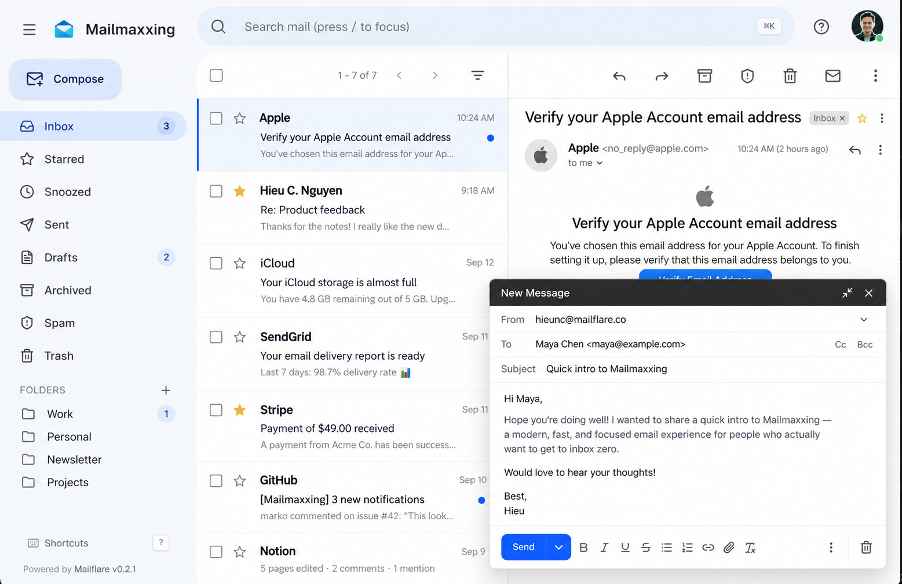
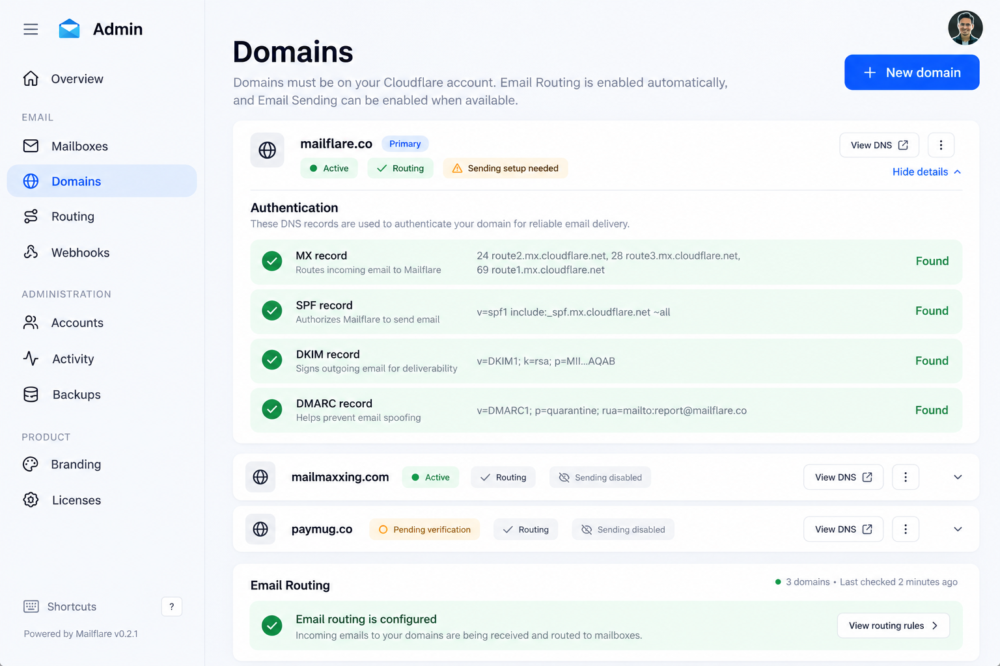
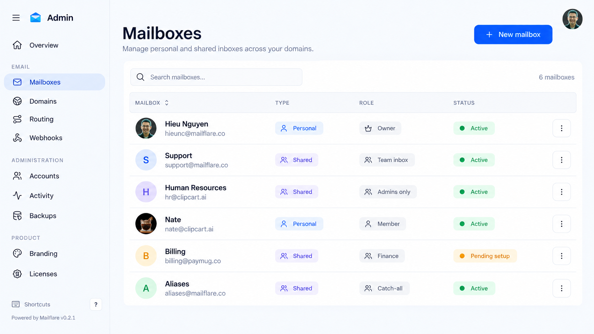
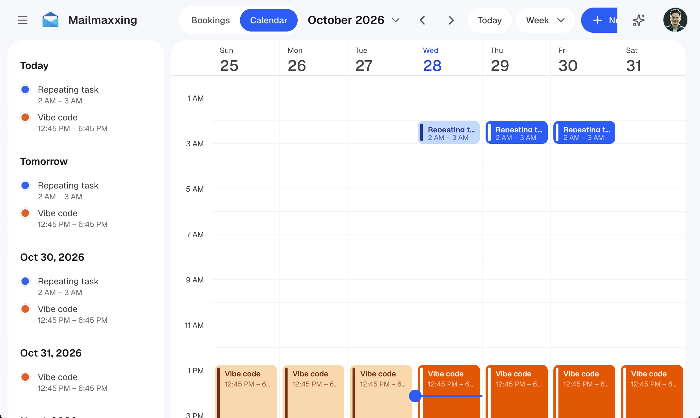
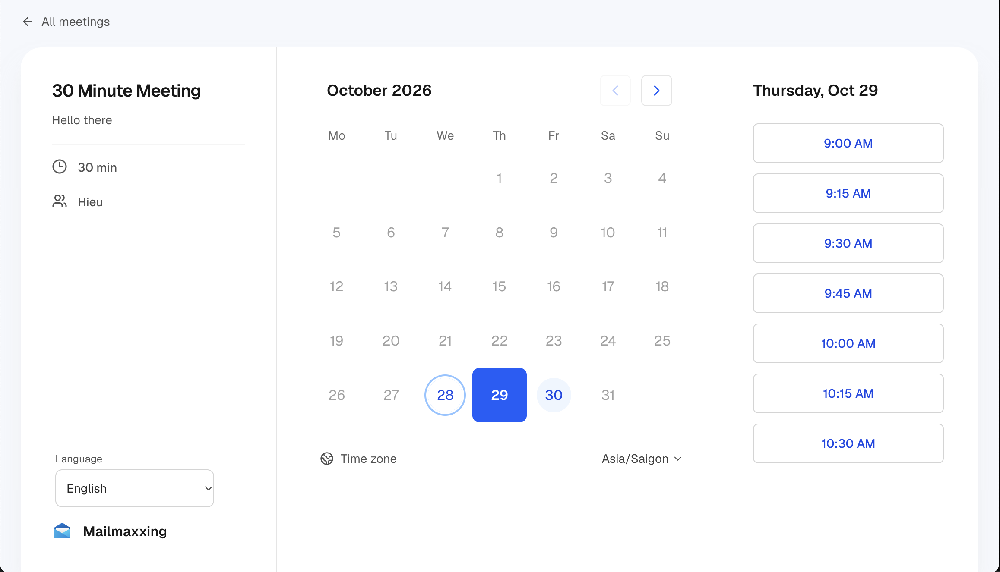
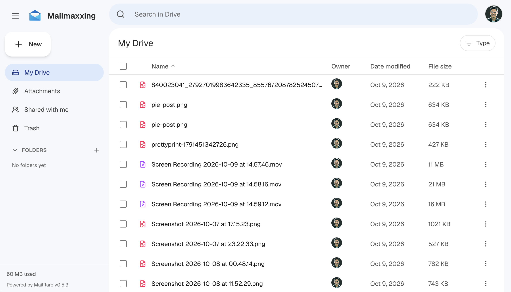

# Mail

A modern, self-hosted alternative to Google Workspace. Built for individuals and teams needing **custom domain emails**, **Calendar**, **Drive**, **Booking**, and **built-in AI assistants** with dual-language translation, summary, and smart composing.

Self-host it on Cloudflare or Docker.

[](https://deploy.workers.cloudflare.com/?url=https://github.com/hautph/mail)

## Screenshots

<table>
  <tr>
    <td align="center"><br>Inbox</td>
    <td align="center"><br>Domains</td>
    <td align="center"><br>Mailboxes</td>
  </tr>
  <tr>
    <td align="center"><br>Calendar</td>
    <td align="center"><br>Booking</td>
    <td align="center"><br>Drive</td>
  </tr>
</table>

## Features

### Apps & Productivity

- **Email**: Custom domain mailboxes (personal or shared) with granular permission control. Send and receive with Cloudflare Email Routing, Resend, or Amazon SES.
- **Gemini AI Assistant & Email Intelligence**:
  - **Tóm tắt nhanh**: Summarize long foreign-language emails into clear, actionable bullet points in Vietnamese.
  - **Dịch thuật 1-chạm**: Instant professional translation of incoming emails.
  - **Dual-Language AI Composer**: Draft in Vietnamese, preview both Vietnamese explanation and English email, and insert the polished English version directly with a single click.
- **AI Agents & MCP**: Mailbox assistants to search mail, draft replies, and manage schedules. Full Model Context Protocol (MCP) server support for connecting external AI tools (Claude Code, Cursor, etc.).
- **Routing Rules**: Store, forward, reject, or automatically sort incoming mail.
- **Calendar**: Recurring events with time zones, schedule conflict checking, and automatic email invitations.
- **Booking**: Share a public booking link so anyone can schedule free slots on your calendar.
- **Drive**: Secure personal and shared file storage.

### Technical Architecture

- **Databases**: Cloudflare D1 (default), PostgreSQL, MySQL, Turso / libSQL, or local SQLite. Set `DATABASE_URL` to switch. Compatible with Supabase, Neon, PlanetScale, TiDB, and more (see [Databases](docs/databases.md)).
- **File Storage**: Cloudflare R2, Backblaze B2, or AWS S3.
- **Hosting Options**: Edge deployment on Cloudflare Workers or single Docker container on any server/VPS.
- **Administration**: Comprehensive user management, passkey/WebAuthn authentication, API keys, webhooks, audit logs, and automated database backups.
- **Data Import**: Migrate existing emails from IMAP, Gmail Takeout, `.eml`, and `.mbox` files.

### Multilingual Support

Mail supports 34 languages out of the box, including English, Tiếng Việt, Português, Español, Français, Deutsch, Italiano, Nederlands, Polski, Русский, Türkçe, 中文（简体）, 日本語, 한국어, Bahasa Indonesia, العربية, and more.

---

## Cost & Free Tier

You can receive and send mail completely free:

- **Receiving**: Cloudflare Email Routing is 100% free with unlimited custom addresses.
- **Sending**: Free tier on Resend (3,000 emails/month) or Amazon SES. Direct Cloudflare outbound worker sending requires the Cloudflare Workers Paid plan ($5/month).
- **AI Features**: Built-in Gemini AI can run with Google AI Studio free tier API key (`GEMINI_API_KEY`).

---

## Quick Start & Deployment

### Option 1: Deploy to Cloudflare Workers

1. **Deploy the application**: Click the **Deploy to Cloudflare** button above, or deploy via Wrangler. (Keep Worker name `mailflare`).
2. **Configure API Secrets**:
   - `CF_TOKEN`: Cloudflare API token with Zone, DNS, and Email Routing permissions.
   - `GEMINI_API_KEY` (optional): For Gemini AI summary, translation, and composer features.
3. **Finish initial setup**: Open `/setup` in your browser to create the primary administrator account.
4. **Connect your domain**: Follow the on-screen steps to configure DNS and activate your custom domain mailbox.

Detailed steps and token scopes are available in the [Deployment Guide](docs/deployment.md).

### Option 2: Deploy with an AI Coding Agent

Paste this prompt into Claude Code, Codex, Cursor, or your preferred agent:

```text
Install the application for me from https://github.com/hautph/mail on my Cloudflare account.

1. Read README.md, docs/deployment.md and wrangler.jsonc first.
2. Ask me for my Cloudflare account ID and two API tokens, using a secret input:
   a deploy token (for Wrangler) and a runtime token (the Worker secret CF_TOKEN).
   Never print them, commit them, or pass them as command arguments.
3. Keep the Worker name exactly "mailflare". Create or reuse the D1 database
   "mailflare", the R2 bucket "mailflare-raw", and the queues "mailflare-inbound",
   "mailflare-outbound" and "mailflare-agent".
4. Install dependencies, run `npm run deploy`, and set CF_TOKEN and optional GEMINI_API_KEY as Worker secrets.
   Do not run remote database migrations yourself. The /setup page does that.
5. Give me the app URL and anything I still need to do. I will open /setup, create
   the admin account and connect my domain.
```

### Option 3: Self-host with Docker

Run as a single container with local SQLite and file storage on any server:

```bash
cp .env.docker.example .env.docker
docker compose up -d --build
```

Or run the prebuilt image:
```bash
docker compose -f docker-compose.image.yml up -d
```

See the [Self-Hosting Guide](docs/self-hosting.md) for volume mounts and reverse proxy configurations.

---

## Local Development

```bash
# 1. Clone & install dependencies
git clone https://github.com/hautph/mail.git
cd mail
npm install

# 2. Configure environment
cp .dev.vars.example .dev.vars
# Add your CF_TOKEN and GEMINI_API_KEY into .dev.vars

# 3. Apply local database migrations
npm run db:migrate:local

# 4. Start local development server
npm run dev
```

Open [http://localhost:3000](http://localhost:3000). Run `npm run db:seed` to load sample data.

### Common Commands

- `npm run dev`: Start local Next.js / Vinext server on port 3000
- `npm run build`: Bundle migrations and build Cloudflare Worker
- `npm run deploy`: Build and deploy to Cloudflare Workers
- `npm run lint`: Run code linter and type-checking
- `npm run db:bundle`: Regenerate migration bundles for all dialects (SQLite, Postgres, MySQL)

---

## Documentation

- [Deployment and Configuration](docs/deployment.md)
- [Databases & Multi-Dialect Migrations](docs/databases.md)
- [Email Assistant & MCP Protocol](docs/email-assistant-and-mcp.md)
- [Email Sending and Receiving Providers](docs/providers.md)
- [Self-Hosting with Docker](docs/self-hosting.md)
- [API and Webhooks](docs/api.md)
- [Localization Guide](docs/localization.md)
- [Troubleshooting](docs/troubleshooting.md)

## License

See [LICENSE](LICENSE).
